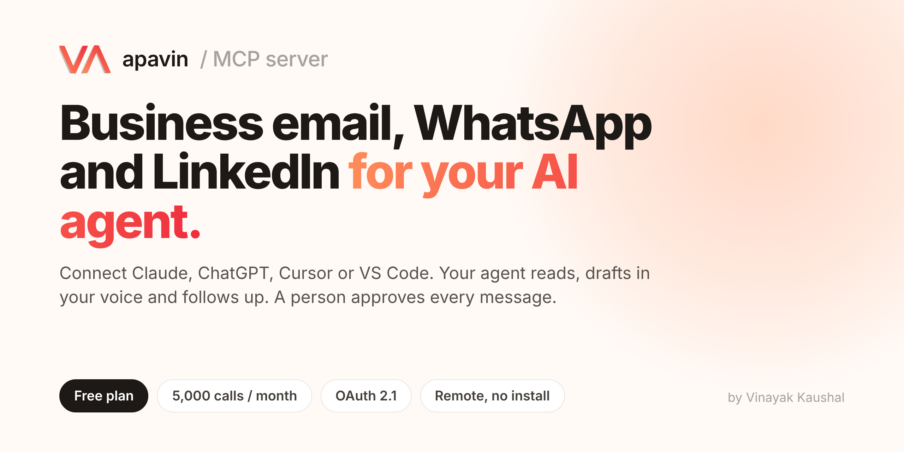
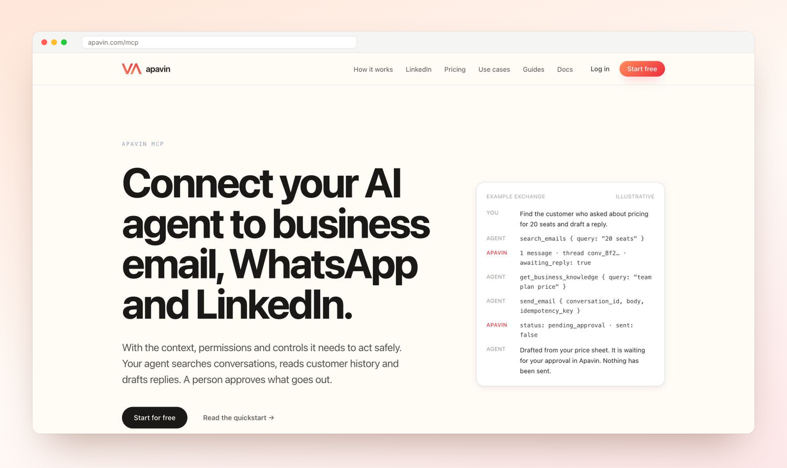
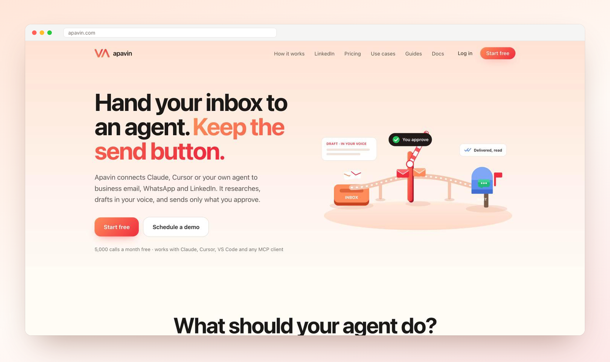
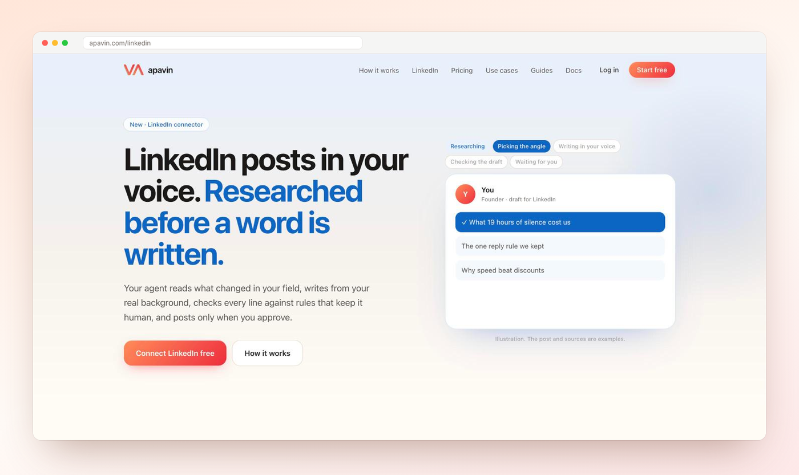
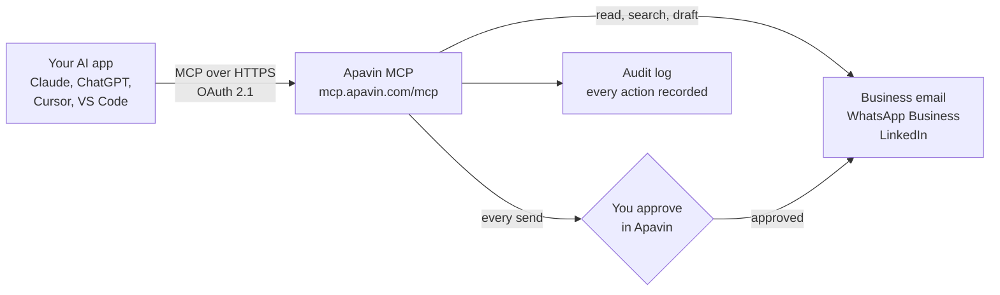
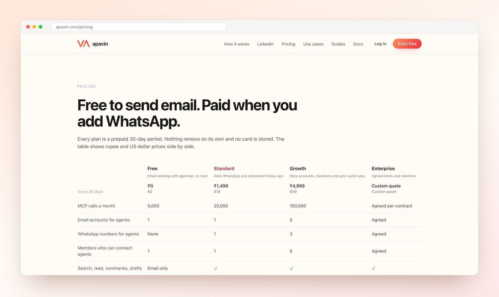
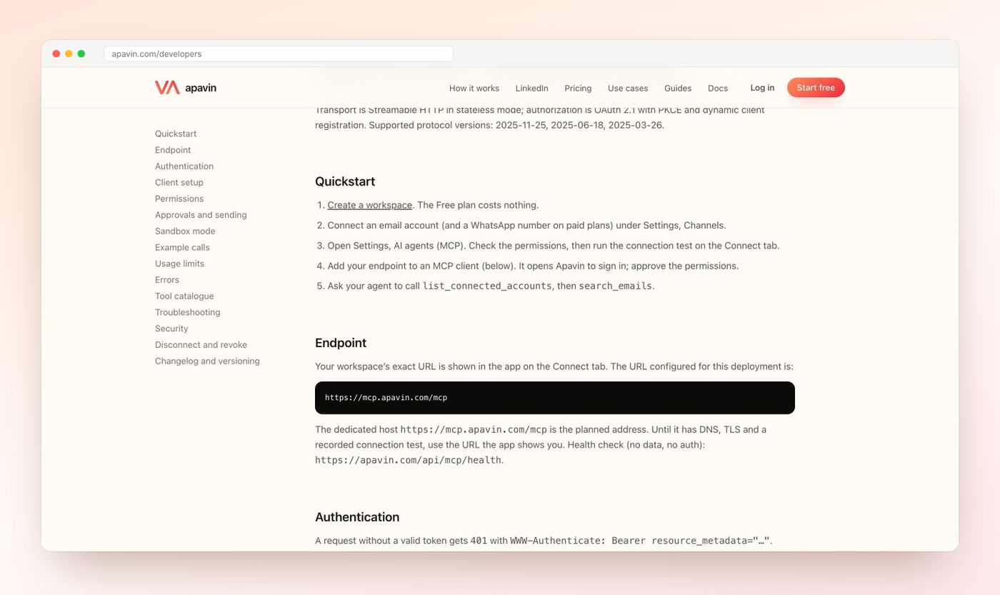

<div align="center">

<a href="https://apavin.com/mcp?ref=github"></a>

<h1>Apavin MCP Server</h1>

<p><strong>Give Claude, ChatGPT, Cursor or VS Code safe access to your business email, WhatsApp and LinkedIn.</strong><br>
Your agent finds who is waiting, drafts replies and posts in your voice, and follows up. A person approves every message before it goes out.</p>

[](https://apavin.com/signup?ref=github)
[](https://apavin.com/developers)
[](https://apavin.com/developers#authentication)
[](#tools)

[](https://cursor.com/en/install-mcp?name=apavin&config=eyJ1cmwiOiJodHRwczovL21jcC5hcGF2aW4uY29tL21jcCJ9)
[](https://insiders.vscode.dev/redirect/mcp/install?name=apavin&config=%7B%22type%22%3A%22http%22%2C%22url%22%3A%22https%3A%2F%2Fmcp.apavin.com%2Fmcp%22%7D)
[](https://insiders.vscode.dev/redirect/mcp/install?name=apavin&config=%7B%22type%22%3A%22http%22%2C%22url%22%3A%22https%3A%2F%2Fmcp.apavin.com%2Fmcp%22%7D&quality=insiders)

**[Start free](https://apavin.com/signup?ref=github)** · [Website](https://apavin.com/mcp?ref=github) · [Docs](https://apavin.com/developers) · [Pricing](https://apavin.com/pricing) · [Claude plugin](https://github.com/vinayak0920/apavin-mcp)

</div>

---

## Get started in 2 minutes

**1. Create a free Apavin account** at **[apavin.com/signup](https://apavin.com/signup?ref=github)**. No card, no time limit.

**2. Connect your business email** in Apavin under **Settings, Channels**. Gmail, Google Workspace, Outlook, Microsoft 365, Zoho or any IMAP host.

**3. Add the server to your AI app.** It is a remote server, so there is nothing to install or run:

```
https://mcp.apavin.com/mcp
```

The first time your agent uses it, Apavin opens in your browser. Sign in and approve the permissions. That is the whole setup.

**4. Ask for something real:**

> *"Who is waiting on a reply from us? Draft answers from our price sheet."*

## Connect your AI app

<details open>
<summary><b>Claude (claude.ai and Claude Desktop)</b></summary>

1. Open **Settings**, then **Connectors**, then **Add custom connector**.
2. Name it `Apavin` and paste `https://mcp.apavin.com/mcp` as the URL.
3. Choose **Connect**, sign in to Apavin and allow access.

Prefer a plugin with ready-made skills and background agents? Use **[vinayak0920/apavin-mcp](https://github.com/vinayak0920/apavin-mcp)**.

</details>

<details>
<summary><b>Claude Code</b></summary>

```bash
claude mcp add --transport http apavin https://mcp.apavin.com/mcp
```

Then run `/mcp` inside Claude Code and choose **Authenticate** for `apavin`.

</details>

<details>
<summary><b>ChatGPT</b></summary>

1. Turn on **Developer mode** in ChatGPT's connector settings.
2. Create a connector with the URL `https://mcp.apavin.com/mcp` and authentication set to **OAuth**.
3. Sign in to Apavin, allow access, then type `@Apavin` in a chat.

</details>

<details>
<summary><b>Cursor</b></summary>

Click **[Add to Cursor](https://cursor.com/en/install-mcp?name=apavin&config=eyJ1cmwiOiJodHRwczovL21jcC5hcGF2aW4uY29tL21jcCJ9)**, or add this to `~/.cursor/mcp.json`:

```json
{
  "mcpServers": {
    "apavin": {
      "url": "https://mcp.apavin.com/mcp"
    }
  }
}
```

</details>

<details>
<summary><b>VS Code (GitHub Copilot agent mode)</b></summary>

Click **[Install in VS Code](https://insiders.vscode.dev/redirect/mcp/install?name=apavin&config=%7B%22type%22%3A%22http%22%2C%22url%22%3A%22https%3A%2F%2Fmcp.apavin.com%2Fmcp%22%7D)**, or add this to `.vscode/mcp.json`:

```json
{
  "servers": {
    "apavin": {
      "type": "http",
      "url": "https://mcp.apavin.com/mcp"
    }
  }
}
```

</details>

<details>
<summary><b>Any other MCP client</b></summary>

Clients that speak Streamable HTTP with OAuth can use the URL directly. Clients that only run local servers can bridge with [`mcp-remote`](https://www.npmjs.com/package/mcp-remote):

```json
{
  "mcpServers": {
    "apavin": {
      "command": "npx",
      "args": ["-y", "mcp-remote", "https://mcp.apavin.com/mcp"]
    }
  }
}
```

Ready-made files for each client are in [`configs/`](configs).

</details>

## What your agent can do

<p align="center"></p>

| | What it means for you |
|---|---|
| **Nobody waits** | Your agent lists every customer who wrote last and heard nothing back, across email and WhatsApp, oldest first. |
| **Replies in your voice** | It learns from emails your team actually sent and drafts from your own price sheet and policies, never from a guess. |
| **You keep the send button** | Every email, WhatsApp message and LinkedIn post waits in Apavin until a person approves it. |
| **Follow-ups that happen** | Schedule a follow-up for 5 minutes to 90 days ahead. It goes only after approval. |
| **LinkedIn posts** | Researched, written from your real background, checked against writing rules, published when you say so. |
| **Background agents** | Inbox replies, follow-ups and LinkedIn posts on a schedule, run by your own Claude or ChatGPT. |

<table>
<tr>
<td width="50%"></td>
<td width="50%"></td>
</tr>
<tr>
<td align="center"><sub>Every message waits for your approval</sub></td>
<td align="center"><sub>LinkedIn posts in your voice, researched first</sub></td>
</tr>
</table>

## How it works



1. Your AI app calls Apavin's tools over MCP, signed in with OAuth. No passwords or API keys are pasted into the app.
2. Apavin reads and searches your connected inboxes and numbers, and gives the agent only what its permissions allow.
3. Anything outbound becomes a draft or a `pending_approval` message. Nothing reaches a customer until a person approves it.
4. Every call is logged with who asked, which account and what happened.

## Tools

40 tools, grouped by what they touch. Full schemas: **[apavin.com/developers#tools](https://apavin.com/developers#tools)** and [`docs/tools.md`](docs/tools.md).

| Area | Tools |
|---|---|
| **Daily workflow** | `get_reply_queue`, `get_reply_guidelines`, `add_customer_note`, `create_follow_up_task`, `get_sent_email_samples`, `save_voice_profile` |
| **Email** | `search_emails`, `get_email_thread`, `get_email_message`, `summarize_email_thread`, `create_email_draft`, `update_email_draft`, `send_email`, `schedule_email_follow_up`, `get_email_delivery_status` |
| **WhatsApp** | `search_whatsapp_conversations`, `get_whatsapp_conversation`, `get_whatsapp_message`, `create_whatsapp_reply_draft`, `send_whatsapp_reply`, `send_whatsapp_template`, `schedule_whatsapp_follow_up`, `cancel_scheduled_message`, `get_whatsapp_delivery_status` |
| **LinkedIn** | `get_linkedin_profile`, `check_linkedin_post`, `create_linkedin_post_draft`, `publish_linkedin_post`, `create_linkedin_image`, `record_linkedin_post_stats` |
| **Customer context** | `get_customer_context`, `search_customer_conversations`, `get_business_knowledge`, `list_connected_accounts` |
| **Control and audit** | `get_action_permissions`, `get_usage_summary`, `get_recent_action_logs` |
| **Background agents** | `list_background_agents`, `start_agent_run`, `finish_agent_run` |

## Free plan

| Free, forever | |
|---|---|
| MCP calls | **5,000 a month** |
| Email | One account: search, read, summaries, drafts, and sending after approval |
| LinkedIn | 12 posts a week in your voice, published after you approve |
| Card | Not needed |
| Time limit | None |

WhatsApp, scheduled follow-ups, more accounts and team members come with paid plans from **$19 (₹1,499) per 30 days**. Nothing renews on its own. See **[apavin.com/pricing](https://apavin.com/pricing)**.

<p align="center"></p>

## Security and permissions

- **OAuth 2.1 with PKCE** and dynamic client registration. Revoke any connection from Apavin at any time.
- **Scoped permissions.** Each connection gets only the scopes you grant: `email:read`, `email:draft`, `email:send`, `whatsapp:read`, `whatsapp:draft`, `whatsapp:send`, `whatsapp:template`, `followups:schedule`, `context:read`, `customers:write`, `audit:read`, `linkedin:read`, `linkedin:draft`, `linkedin:publish`.
- **Human approval** before any email, WhatsApp message or LinkedIn post is sent.
- **Untrusted content stays text.** Customer messages are marked untrusted, so an instruction hidden in an email is never treated as a command.
- **Exactly-once sends** with idempotency keys, so a retry never sends twice.
- **Credentials are never returned** to the agent. Mailbox passwords and tokens stay in Apavin.

More: **[apavin.com/security](https://apavin.com/security)**.

## Developer reference

<p align="center"></p>

| | |
|---|---|
| Endpoint | `https://mcp.apavin.com/mcp` |
| Transport | Streamable HTTP, stateless |
| Auth | OAuth 2.1, PKCE, dynamic client registration |
| Protected resource metadata | [`/.well-known/oauth-protected-resource/mcp`](https://mcp.apavin.com/.well-known/oauth-protected-resource/mcp) |
| Protocol versions | 2025-11-25, 2025-06-18, 2025-03-26 |
| Health check | `https://apavin.com/api/mcp/health` |
| Registry entry | [`server.json`](server.json) |

## FAQ

<details>
<summary><b>Is Apavin MCP really free?</b></summary>

Yes. The Free plan has 5,000 MCP calls a month, one email account and LinkedIn posting, with no card and no time limit.
</details>

<details>
<summary><b>Can my AI agent send email without me?</b></summary>

Not by default. Every send becomes `pending_approval` and waits for a person in Apavin. Paid plans can add auto-send rules that you set yourself.
</details>

<details>
<summary><b>Does Apavin store my email password?</b></summary>

Apavin stores the mailbox connection, encrypted, so it can read and send for you. It is never passed to your AI app or shown to the agent.
</details>

<details>
<summary><b>Which AI apps work with Apavin?</b></summary>

Any app that supports remote MCP servers: Claude, Claude Code, ChatGPT, Cursor, VS Code and others. Apps that only run local servers can use `mcp-remote`.
</details>

<details>
<summary><b>Do I need to run anything on my computer?</b></summary>

No. Apavin is a hosted remote server. You paste one URL and sign in.
</details>

## Author

<table>
<tr>
<td><a href="https://apavin.com/about"></a></td>
<td>
<b>Vinayak Kaushal</b><br>
Cofounder and CEO, <a href="https://apavin.com">Apavin</a><br>
Built Apavin MCP so a small team can hand its inbox to an AI agent and still approve every word that goes out.<br>
<a href="https://apavin.com/about">About</a> · <a href="mailto:vinayak@apavin.com">vinayak@apavin.com</a> · <a href="https://x.com/Apavin_in">@Apavin_in</a>
</td>
</tr>
</table>

## Support

- Questions and bugs: [open an issue](../../issues) or email [sales@apavin.com](mailto:sales@apavin.com).
- Docs: [apavin.com/developers](https://apavin.com/developers)
- Status of the endpoint: `https://apavin.com/api/mcp/health`

---

<div align="center">
<sub>Made in India by <a href="https://apavin.com/about">Vinayak Kaushal</a> · <a href="https://apavin.com">apavin.com</a> · Apavin is a hosted service. This repository holds its public docs, configs and registry entry.</sub>
</div>
